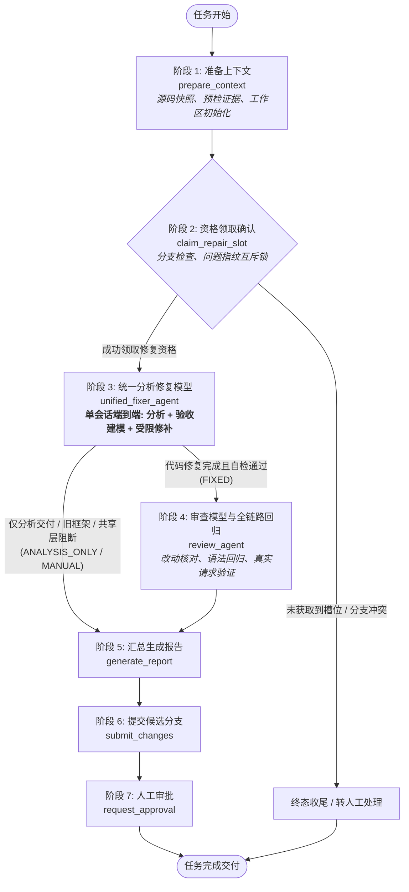
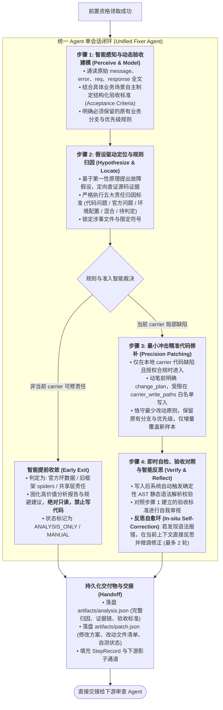

# AI 异常自动修复工作台 (AI Bug Fixer)

本系统基于 **LangGraph** 编排引擎，实现了**单会话端到端统一分析修复智能体**与 **7 大公开业务执行阶段**的全局工作流自动化。

---

## 一、 全局业务流转架构（Macro Workflow Architecture）

工作流执行顺序严格前置了资格确认，并在单一 Agent 完成后直接将产物递交审查 Agent：



### 7 大公开阶段执行节点

1. **`01_prepare_context`（准备上下文）**：组合执行分支预检、源码快照生成、隔离工作区部署与确定性预检证据提取。
2. **`02_claim_slot`（资格领取确认）**：前置拦截。检查任务问题指纹互斥锁与分支冲突，拦截并发与重复认领，零浪费大模型 Token。
3. **`03_unified_fixer`（统一分析修复模型）**：在单一 LLM 会话生命周期内端到端完成异常感知建模、假设定位归因、智能提前收敛判定、受限精准修补与 AST 语法自检。
4. **`04_review`（审查模型与全链路回归）**：执行代码改动范围比对、确定性语法回归、原问题重放与真实请求业务回归验证。
5. **`05_generate_report`（汇总生成报告）**：准备候选交付物。修复任务提交本地候选分支并绑定证据，纯分析任务交付 `final.json` 决策报告。
6. **`06_submit_changes`（提交候选分支）**：将通过审查并完成准备的修复候选分支推送至远程 Git 仓库。
7. **`07_request_approval`（人工审批）**：终态交付前的最后一道把关，人工复核决定保留或打回。通过则交付完成，驳回则打回统一模型重修。

> 注：`00_log_pipeline` 为批次级日志发现、规范化与去重组合入口；`99_finalize` 为终态收尾/异常转人工处理节点。

---

## 二、 统一 Agent 内部智能化四阶段编排流程

`unified_fixer_agent` 运行在**单一 LLM 会话生命周期（Single Continuous Session）**中，思维链连贯无损，内部编排为四个自适应智能阶段：



### 五大责任归因标准
1. **`code`（【代码问题】）**：有效输入被错误解析，或已知业务状态落入未处理分支；有源码证据支持本地 carrier 缺陷。
2. **`official`（【官方问题】）**：原始响应本身异常、服务故障、拦截、占位值或脏数据，未证明本地违反现有契约。
3. **`environment`（【环境配置问题】）**：代理、权限、依赖、规则服务、配置或共享基础设施导致。
4. **`mixed`（【混合问题】）**：官方异常同时触发本地明确的错误处理缺陷。
5. **`pending`（【待判定】）**：现有事实存在多个合理解释，关键证据缺失。

### 产物双落盘机制
- **`artifacts/analysis.json`**：收录问题归因、事实清单、源码证据、验收标准、拟修改目标及缺口分析。
- **`artifacts/patch.json`**：收录变更文件清单、结构化 `change_plan`、确定性 AST 语法校验结果与反思微调记录。

---

## 三、 系统工程目录结构（权威对齐规范）

系统采用极致简洁、职责单一的工程结构，全链路状态机基于 **LangGraph**：

```text
ai_bug_fixer/
├── config/                         # 全局配置中心 (Settings & Nacos)
│   ├── settings.py                 # 全局基础配置参数与阈值
│   ├── nacos.py                    # Nacos 配置拉取与动态监听
│   └── services/                   # 注册服务登记表清单
│
├── core/                           # 核心基础层 (单一事实源，彻底消除跨目录重复)
│   ├── contracts.py                # 统一数据契约与状态快照模型 (TaskSnapshot, StepRecord 等)
│   ├── errors.py                   # 领域异常定义 (StepFailed, PolicyError 等)
│   ├── policy.py                   # 统一执行策略 (白名单路径、模型分配、范围门禁)
│   └── keys.py                     # 任务指纹、问题Key与分支名称算法
│
├── infrastructure/                 # 外部系统与底层支撑 (纯粹的技术实现)
│   ├── llm/                        # 大模型客户端与调用保护 (Anthropic/Claude, TokenBudget)
│   ├── git/                        # Git 仓库操作 (本地拉取、代码提交、远程推送、分支检查)
│   ├── es/                         # 日志检索与数据同步 (Elasticsearch/日志源提取)
│   ├── workspace/                  # 隔离文件工作区与安全清理 (WorkspaceManager, Diff, GC)
│   └── storage/                    # 运行记录与产物落盘 (RecordStore, SqliteClaimLock)
│
├── agents/                         # 智能体自治闭环 (Single Continuous Session)
│   ├── unified_fixer/              # 阶段3: 统一分析修复 Agent
│   │   ├── graph.py                # 单会话四阶段编排 (感知建模->归因->修补->AST自检)
│   │   ├── models.py               # 输入输出契约
│   │   ├── provider.py             # 会话流管理
│   │   └── prompt.md               # 提示词模板
│   └── review/                     # 阶段4: 审查智能体与确定性门禁
│       ├── graph.py                # 审查子图编排
│       ├── contract.py             # 审查维度定义
│       ├── prompt.md               # 审查提示词
│       └── gates/                  # 确定性门禁工具 (语法回归、改动范围比对、真实请求验证)
│
├── workflow/                       # 业务工作流编排中枢 (直接对齐权威执行生命周期)
│   ├── engine/                     # 编排引擎与状态路由 (严格收敛为 4 大核心文件)
│   │   ├── graph.py                # 全图构建与编译 (LangGraph 状态机与 Checkpoint)
│   │   ├── runner.py               # 步骤执行与审计记录调度 (StepRunner)
│   │   ├── routes.py               # 阶段流转条件分支判断与验收断言
│   │   └── handoff.py              # 状态快照与阶段数据移交
│   │
│   └── stages/                     # 权威执行阶段 (与业务阶段 1:1 物理对应)
│       ├── 00_log_pipeline/        # 批次触发: 日志发现、规范化与去重 (discover/normalize)
│       ├── 01_prepare_context/     # 阶段1: 源码快照、预检证据、工作区初始化
│       ├── 02_claim_slot/          # 阶段2: 资格领取确认 (分支检查与互斥锁)
│       ├── 03_unified_fixer/       # 阶段3: 统一分析修复执行适配器
│       ├── 04_review/              # 阶段4: 审查模型与全链路回归适配器
│       ├── 05_generate_report/     # 阶段5: 汇总生成报告与交付产物准备
│       ├── 06_submit_changes/      # 阶段6: 提交候选分支至远程 Git 仓库
│       ├── 07_request_approval/    # 阶段7: 人工审批与保留/撤回决策
│       └── 99_finalize/            # 收尾与异常转人工处理 (finalize_execution)
│
├── server.py                       # 系统主入口文件 (FastAPI 应用构建、生命周期与 uvicorn 服务)
├── server/                         # 统一 Web 交互与控制台服务
│   ├── routes/                     # 业务接口路由 (按领域物理拆分)
│   │   ├── runs.py                 # 运行管理路由 (启动/暂停/恢复/重试/取消/看板)
│   │   ├── tasks.py                # 任务详情与单步调试路由
│   │   ├── approvals.py            # 人工审批列表与审批决断处理
│   │   ├── artifacts.py            # 产物下载与内容展示路由
│   │   ├── common.py               # 路由共享底层认证、锁管理与数据处理
│   │   └── __init__.py             # 统一 APIRouter 挂载聚合中心
│   └── projections.py              # 前端视图投影与看板统计
│
├── frontend/                       # React + Vite 前端看板
├── tests/                          # 单元与集成核心自动化测试套件
├── .env.example                    # 环境配置范例
└── README.md                       # 系统架构说明文档
```

---

## 四、 快速开始与验证指令

```bash
# 1. 导出前端类型契约 (与后端模型保持强类型同步)
python -m workflow.engine.handoff

# 2. 前端编译与生产打包验证 (TypeScript 类型安全校验)
npm --prefix frontend run build

# 3. 运行全量自动化测试套件
python -m pytest tests/ --ignore=runtime -q

# 4. 启动统一 Web 服务
python server.py
```


## server.py 统一启动入口

```powershell
python server.py                         # 新建并执行一次流程，直到人工审批或终态
python server.py --web                   # 同时启动 API，保留在线人工审批入口
python server.py --frontend              # 同时启动 API 和 Vite 前端
python server.py --serve-only            # 只启动 API，不新建批次
python server.py --serve-only --frontend # 只启动前后端，用于审批已有批次
python server.py --run-id my-new-run     # 指定新批次 ID；已有 ID 不会覆盖
```

参数与连接配置继续读取现有配置。无界面模式到达人工审批后保留 checkpoint，不会自动批准；随后可启动工作台继续审批。前端依赖需先在 `frontend` 目录运行 `npm install`。前后端模式持续提供服务，直到手动退出；退出时会关闭本入口启动的前端进程。

人工审批完成、取消或无法继续恢复时统一进入终态收尾，写入最终报告并释放修复资格。审查回修次数耗尽走失败收尾报告，不向提交节点发送未通过的补丁。
